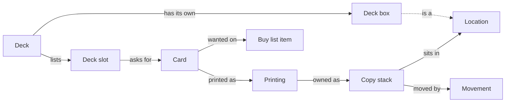

# Rift Library: Concepts and Data Model

Oct 23, 2026 · @Jeff

Part of the [Rift Library: PRD](README.md). Rewritten from [Library of Gathering: Concepts and Data Model](https://github.com/qiuey00/library-of-gathering-v2/blob/main/docs/prd/concepts-and-data-model.md); the core rule, the worked-out values and the movement rules are unchanged. Status: draft v0.1.

## The core rule

Every physical copy is in exactly one location at a time, and an assembled deck has its own location: its deck box. Everything else is worked out from where copies are, so the app never stores a second version of the truth (D-11, D-12).

That means no reservations, no stored deck state and no stored shortages. A deck's state, the copies free to pull and the cards in short supply are all calculated from copy locations and decklists whenever they are shown.

## At a glance

Read along the arrows: a deck lists slots, each slot asks for a card, and a card's printings are owned as copy stacks that sit in locations. A deck's box is one of those locations, which is how an assembled deck holds real copies.

## Entities

Eight entities cover v1, the same eight as Library of Gathering. Only three of them (copy stack, location, movement) describe the physical world; the rest describe cards and plans.

| Entity | What it is | Key fields | Comes from |
| --- | --- | --- | --- |
| Card | One game card, whatever its printing, such as Jinx, Loose Cannon | Name, card type, supertype (such as Champion or Signature), domains, energy, might, power, rules text, champion tag | Riftcodex, grouped by name |
| Printing | One version of a card | Set, collector number, public code (such as OGN-001/298), Riftcodex id, TCGplayer id, available finishes, image, artist, alternate art, overnumbered and signature flags, price per finish | Riftcodex, with prices from TCGCSV |
| Copy stack | Physical copies of one printing that are alike and sit together | Printing, quantity, finish, condition, language, misprint, altered, real or proxy, purchase price (kept, not shown), location, came-from location | Adding by search |
| Location | Any place copies sit | Name, type (binder, box, deck box, tray, inbox), parent location, color, for trade | Created by Jeff; one "to sort" inbox always exists |
| Deck | A Riftbound decklist | Name, deck box location | Built in the app or pasted from a deck list |
| Deck slot | One line of a decklist | Deck, card, board (legend, champion, main, battlefield, rune, sideboard or maybe), quantity, picked printing, printing hint, tags | Deck editing, deck list import |
| Movement | One recorded move of copies | Copy stack, quantity, from, to, reason, deck, time | Written by every move |
| Buy list item | A card Jeff chose to buy | Card, printing if chosen, quantity, note, date added | Added by hand only |

## Boards

A Riftbound deck is more than one pile, so a deck's slots sit on seven boards. Every board except the maybe board is real cards that live in the deck box (D-21, D-22).

| Board | Holds | Pulled into the deck box | Counts toward demand |
| --- | --- | --- | --- |
| Legend | The deck's one Champion Legend | Yes | Yes |
| Champion | The Chosen Champion unit, whose champion tag matches the Legend | Yes | Yes |
| Main | The rest of the main deck: units, spells, gear and signature cards | Yes | Yes |
| Battlefield | The deck's battlefields, usually 3 | Yes | Yes |
| Rune | The 12 runes, as counts per domain | No, runes are always available | No |
| Sideboard | Optional; cards swapped in between games | Yes | Yes |
| Maybe | Cards Jeff is considering but that aren't in the deck | No | No |

The Chosen Champion counts toward the main deck's 40 cards in the checks, but sits on its own board so the deck view and pick list can show it first, as Commander did in Library of Gathering.

## Worked-out values

None of these values is stored; each is calculated from copy locations and decklists when it is shown.

| Value | How it is worked out | Where it shows |
| --- | --- | --- |
| Owned copies | Sum of copy stack quantities across every printing of the card, proxies included; counts show how many are proxies | Card page, search results |
| Copies in decks | Owned copies whose location is a deck box | Card page, "where is it?" |
| Free copies | Owned copies minus copies in decks | Deck overlay, pick list |
| Deck demand | Total quantity of the card on the legend, champion, main, battlefield and sideboard boards of all decks; maybe boards and runes never count | Card page, deck overlay |
| Shortage | Deck demand minus owned copies, when above zero | Warning on deck slots and the card page |
| Slot filled | Copies of the slot's card sitting in that deck's box reach the slot's quantity | Deck view, pick list |
| Deck state | Not assembled when no slot is filled, assembled when every legend, champion, main, battlefield and sideboard slot is filled, partly assembled in between; rune and maybe slots are left out | Deck list, deck view |
| Value | Quantity times the TCGplayer market price for the stack's finish; proxies and stacks with no price count as zero, and real copies with no price are counted as no price | Collection, Locations, deck view |
| Domain identity | The domains of the deck's Legend | Deck checks, card search while building |

## Rules

These rules keep the records matching the shelves as cards move. All of them come over from Library of Gathering unchanged except Runes, which replaces Basic lands.

- **Splitting and merging:** moving part of a stack splits it in two. Stacks that match on printing, finish, condition, language, misprint, altered, real or proxy, location and came-from location merge back into one.
- **Pulling:** ticking a card on the pick list moves the copy from storage into the deck box, sets its came-from location to the storage it left, and records a movement.
- **Picking a printing:** an unpicked slot accepts any printing of its card, alternate art and signature printings included. When a copy is pulled, the slot's picked printing becomes that copy's printing, so the decklist shows what is really in the box (D-16).
- **Pulling from another deck:** when storage has no free copy, the pick list offers copies in other deck boxes. The copy keeps its original storage spot as its came-from location, so it goes back to storage, not to the other deck, when it is returned. The other deck becomes partly assembled.
- **Returning:** taking a deck apart sends each copy back to its came-from location and clears it. Before confirming, Jeff can mark exceptions and pick a different location for chosen copies; that location then becomes the copy's spot.
- **Proxies:** proxy stacks have locations, fill slots and appear on pick lists like real copies. They count as owned copies when working out shortages, owned counts show how many are proxies, and they are left out of value (D-14).
- **Runes:** runes are treated as always available, as basic lands were in Library of Gathering. They are not tracked as copies, never count toward demand or shortages, and appear at the end of the pick list as counts per domain, such as "6 Fury Rune, 6 Chaos Rune" (D-15).
- **Maybe board:** cards on the maybe board are never pulled and never count toward demand.
- **History:** every change of location writes one movement. Undo writes the reverse movement instead of deleting history.

## Card data

Card data comes from Riftcodex, a free fan-run Riftbound card API, and prices from TCGplayer through TCGCSV (D-7, D-8). The technical design has the details.

- **Cards and printings.** Riftcodex returns one record per printing. The app groups records by card name into cards, so an alternate art or signature printing is another printing of the same card, and a slot accepts any of them.
- **Finishes.** Riftbound printings come in normal and foil. Riftcodex doesn't say which finishes a printing has, so they come from TCGplayer's price entries for the printing (Normal, Foil). A printing with no price entries offers both.
- **Tokens and other non-deck cards.** Cards that can't go in a deck, such as tokens, are kept so they can still be owned and stored, but deck building leaves them out.

## Deck lists

Decks are built in the app or pasted as a deck list (D-23). The deck list format follows the samples Jeff will provide when the Decks step starts. Until then, the import reads plain lines of quantity and card name grouped under board headings such as "Legend:", "Champion:", "Main:", "Battlefields:", "Runes:", "Sideboard:" and "Maybe:", and the export writes the same.

- A line with a public code (such as OGN-001) after the name keeps it as the slot's printing hint.
- Repeated names on one board merge into one slot with the total quantity.
- A name the app doesn't know is listed in the preview to fix by search or skip.

## Open questions for Jeff

- [ ] Should sideboard cards be pulled into the deck box with the rest of the deck, and count toward demand? Default: yes, since they travel with the deck (Boards table above).
- [ ] Should the Chosen Champion have its own board, as above, or just be a main deck card that the deck checks look for? Default: its own board, shown first like Commander was.
