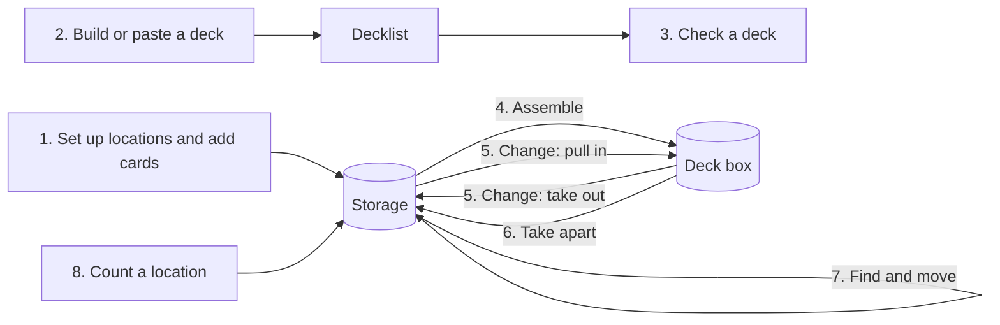

# Rift Library: Key Flows

Oct 23, 2026 · @Jeff

Part of the [Rift Library: PRD](README.md). These are the eight flows the MVP must support, step by step, written against the entities in [Rift Library: Concepts and Data Model](concepts-and-data-model.md). They follow [Library of Gathering: Key Flows](https://github.com/qiuey00/library-of-gathering-v2/blob/main/docs/prd/key-flows.md): flows 3, 4, 6 and 7 carry over almost word for word, and flows 1, 2, 5 and 8 lose ManaBox and Moxfield. Status: draft v0.1.

## Flow map

Six flows move physical copies; flows 2 and 3 only work with decklists and read where copies are.

Every arrow into storage or a deck box writes a movement to history, so each move can be undone.

## Flow 1: Set up locations and add the collection

Jeff describes where the cards live, then adds cards into those places. Most of the collection is added by hand, so adding many cards in a row has to be quick (D-13).

1. On first open, the app already has one location: the "to sort" inbox.
2. Jeff creates the locations, each with a name, a type (binder, box, deck box, tray) and an optional parent, such as rows inside a box. Binders are one location each, with no pages or slots.
3. Jeff picks Add cards and chooses a location, which defaults to the "to sort" inbox.
4. Jeff types a card name or a public code such as OGN-042. The app shows matching printings with their images, set and collector number, alternate art and signature printings included.
5. Jeff picks the printing, then sets quantity, finish, condition, language and real or proxy. Each field starts at the last value used, so a run of near mint English normal copies needs only the name and Enter.
6. The copies are added at once, the undo bar names them, and the search box clears for the next card. The location stays until Jeff changes it.
7. Jeff files inbox cards into their homes with Flow 7, and marks proxies afterwards by selecting stacks and choosing Mark as proxy.

A CSV import waits for a sample of whatever Jeff uses today (Open questions).

**Records:** one movement per new stack, with no from location and the reason "added", so history shows when each card arrived.

## Flow 2: Build or paste a deck

A deck starts as a decklist only: no copies move until Flow 4.

**In the app**

1. Jeff picks New deck and searches for a Legend; only Champion Legends appear.
2. The Chosen Champion search shows only champion units whose champion tag matches the Legend.
3. Card search for the main deck and sideboard is filtered to the Legend's domains, and each card added becomes a slot on the board it was added to. Battlefield search shows only battlefields.
4. Jeff sets the rune counts per domain, such as 6 and 6.
5. Every slot shows its ownership status from the moment it is added (Flow 3).

**From a deck list**

1. Jeff picks New deck, then pastes a deck list or uploads the text file.
2. The app reads the list into boards, merges repeated names into one slot, and keeps any public code as a printing hint.
3. It proposes the Legend and Chosen Champion from the list. Jeff confirms them or picks others.
4. Jeff names the deck. The name defaults to the Legend's name when the list carries none.
5. A preview lists any names the app could not match, to fix by search or skip, and the deck checks (DECK-6). Problems are warnings and do not block the import.
6. Jeff confirms. The deck is saved as not assembled, with an empty deck box location of its own.

**Records:** nothing physical. Slots with a public code keep it as a printing hint for the pick list.

## Flow 3: Check a deck against the collection

The deck view tells Jeff, slot by slot, whether the card can be pulled today and from where. Nothing here is stored; every status is worked out from where copies sit right now.

| Slot status | When | What Jeff can do |
| --- | --- | --- |
| In the deck box | A copy already sits in this deck's box | Nothing; the slot is filled |
| Free in storage | A copy sits in a storage location; the location path is shown | Assemble (Flow 4) |
| Only in other decks | Every owned copy is in another deck's box; those decks are named | Pull it from that deck during Flow 4, proxy it, or buy it |
| Missing | No copy is owned | Add it to the buy list, or add a proxy |
| Rune | Rune slot | Nothing; always available, shown as a count |

1. Jeff opens a deck. A summary sits at the top, for example "38 free, 2 in other decks, 4 missing".
2. A demand warning appears on any card more decks want than Jeff owns, such as "3 decks want this card, you own 2".
3. Proxy copies count as owned and carry a proxy tag.
4. Jeff can select missing or short cards and choose Add to buy list, with a quantity, an optional printing and a note. The buy list is global, and nothing is added without this step.

**Records:** buy list items only.

## Flow 4: Assemble a deck

This is the flow to get right first. Jeff walks a pick list one location at a time, and each tick moves that copy into the deck box on the spot.

1. Jeff opens a not assembled or partly assembled deck and picks Assemble.
2. The app builds the pick list from the unfilled legend, champion, main, battlefield and sideboard slots. It groups lines by location in the order of the location tree, so Jeff visits each binder or box once.
3. Each line shows the card, the quantity and the suggested copy: printing, finish, condition and a proxy tag if it is one. When several copies qualify, the app suggests the decklist's printing first, then real before proxy, then a location already on the route. Jeff can switch to any other free copy.
4. Jeff ticks each card as it is pulled. The copy moves into the deck box, its came-from location is set to the place it left, and the slot's picked printing becomes that copy's printing. Unticking moves it back.
5. Cards with no free copy sit in a last section, "Not in storage":
   - **In another deck:** a line names that deck's box as the location. Ticking it moves the copy over but keeps its original storage spot as came-from. The other deck becomes partly assembled, and the app says so before the move.
   - **Missing:** Jeff leaves a gap, adds the card to the buy list, or adds a proxy straight into the deck box.
6. Runes come last as counts to add from Jeff's runes, such as "6 Fury Rune, 6 Chaos Rune".
7. Jeff can leave at any point. Because filled slots drop off, reopening the pick list shows only what is left; no session is saved.
8. When Jeff picks Done, the deck is assembled if every legend, champion, main, battlefield and sideboard slot is filled, otherwise partly assembled.

**Records:** one movement per tick, with the reason "assembled" and the deck. Pulls from another deck name both decks.

## Flow 5: Change an assembled deck

When the decklist of a built deck changes, the app turns the difference into a short swap list instead of a full teardown.

1. Jeff edits the decklist in the app, or picks Update from deck list and pastes a fresh list. An update replaces the slots, and slots whose card is unchanged keep their picked printing.
2. The deck view shows a swap list with two parts:
   - **Take out:** copies in the box that no slot needs any more, including cards moved to the maybe board. Each shows its came-from location as the destination.
   - **Pull in:** new or raised slots, laid out like a small pick list (Flow 4).
3. Jeff ticks each card as it goes out or comes in. Take-outs follow the return rules in Flow 6, so Jeff can send a card somewhere other than its came-from location.
4. The deck state is worked out again once the swaps are done.

**Records:** one movement per card, with the reason "swapped out" or "swapped in".

## Flow 6: Take a deck apart

Every copy goes back to the spot it came from unless Jeff says otherwise, so a teardown is a walk through a put-away list.

1. Jeff opens an assembled or partly assembled deck and picks Take apart.
2. The put-away list groups copies by destination, in the same location order as the pick list. Each copy's destination is its came-from location. A copy borrowed from another deck goes back to its original storage spot, not to that deck.
3. Copies with no came-from location, such as a proxy added straight into the box, go to the "to sort" inbox.
4. Before confirming, Jeff can mark exceptions:
   - **Send elsewhere:** pick another location. That location becomes the copy's new spot.
   - **Keep in box:** the copy stays, for a partial teardown.
5. Jeff ticks copies off as they are filed, or picks Return all once the cards are put away.
6. The decklist stays. The deck becomes not assembled, or partly assembled if anything was kept, and can be built again later.

**Records:** one movement per copy, with the reason "returned" and the deck. Each returned copy's came-from location is cleared.

## Flow 7: Find a card and move cards

One search answers "where is it?" for any card, and any copy can be moved from the place it is found.

**Find**

1. Jeff types a card name or public code in the search box, which is on every screen.
2. The card page lists every copy stack: quantity, printing, finish, condition, proxy tag and the full location path, such as "Closet › Bulk box 2 › Row C" or "Jinx deck box". Copies in a deck box are marked as in a deck.
3. Below that, the page lists the decks that use the card and any demand warning.
4. Jeff can jump to a location, or select copies and move them.

**Move**

1. Jeff selects copies from a card page, a location or search results, or selects a whole location.
2. Jeff picks Move to, chooses a location and sets how many to move. Moving part of a stack splits it.
3. Moving a copy into a deck box sets its came-from location. Moving it out to any other location clears it, as a return does.
4. A Recently moved list shows the latest moves, and any move can be undone from history.

Filing the "to sort" inbox is a move: Jeff selects inbox cards and moves them to their homes.

**Records:** one movement per stack moved, with the reason "moved". Undo writes the reverse movement.

## Flow 8: Count a location

Library of Gathering's Flow 8 updated a location from a fresh ManaBox export. Without ManaBox, a location is kept current by hand: Jeff opens it, adds or removes copies, and fixes quantities.

1. Jeff opens a location on the Locations screen.
2. Jeff adds missing cards with Add cards (Flow 1), already set to this location.
3. Jeff lowers a stack's quantity or removes it when a card is gone, such as one sold or traded away. The app asks for a reason (sold, traded, lost, miscounted).
4. A copy that sits in a deck box but came from this location is shown in its own group, so Jeff can see what is out of the binder without removing it.

Audit mode, which walks a location card by card, stays in Next (LOC-7).

**Records:** one movement per added or removed stack, with the reason Jeff picked. Removed copies get a movement with no to location.

## Edge cases

These cut across flows; each follows from the core rule that a copy is in exactly one place.

| Situation | What happens |
| --- | --- |
| Two decks want the last copy | Both show a demand warning. Whichever deck is assembled first takes it, and the other deck's pick list offers to pull it from the first. |
| A copy is borrowed from deck B, then deck B is rebuilt | Deck B's pick list offers it from deck A's box. Its came-from location stays the original storage spot throughout. |
| A copy on an open pick list was moved elsewhere | The pick list is worked out again on open. Ticking a stale line says the copy moved and offers another. |
| The Legend changes | Domain identity and the Chosen Champion's tag are checked again, and slots that no longer fit get a warning. |
| Two printings of one card, such as a normal and an alternate art | They are one card, so one slot asks for either, and the copy limit counts them together. |
| An assembled deck is deleted | The app runs the put-away list first (Flow 6), then deletes the decklist. |
| A location with copies is deleted | Jeff moves the copies first, or sends them all to the "to sort" inbox. |
| A pull is undone from history | The reverse movement puts the copy back in its storage spot and the slot is unfilled again. |
| A card moves from the main deck to the sideboard | No copies move: both boards live in the deck box. |

## Open questions

- [ ] Is a quick add with "last value used" for every field (Flow 1, step 5) the right way to add most of the collection? Default: yes.
- [ ] Should removing copies by hand ask for a reason (Flow 8, step 3)? Default: yes, with sold, traded, lost and miscounted.
