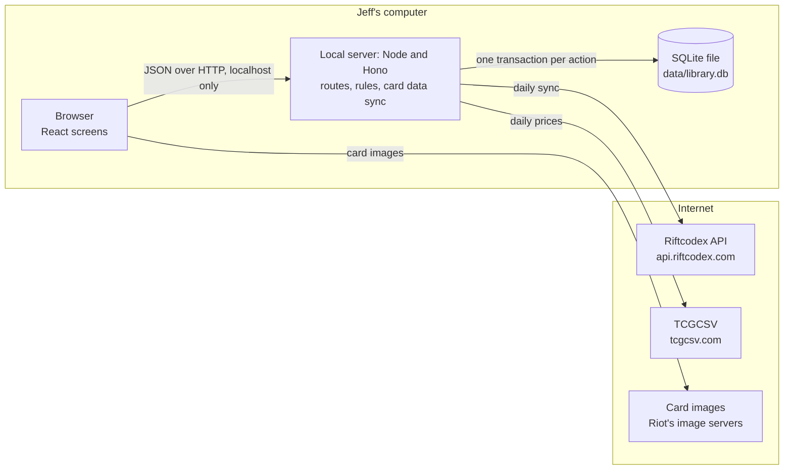

# Rift Library: Technical Design

Oct 23, 2026 · @Jeff

Part of the [Rift Library: PRD](prd/README.md). This doc decides how Rift Library gets built from [Library of Gathering's technical design](https://github.com/qiuey00/library-of-gathering-v2/blob/main/docs/technical-design.md) and code: what stays, the database tables, where card data and prices come from, and the build plan. Anything not mentioned here works as it does in Library of Gathering. Status: draft v0.1.

## Stack

The stack is Library of Gathering's, unchanged (D-2): TypeScript end to end on Node.js 24, React screens built with Vite, Tailwind CSS with shadcn/ui on Radix, TanStack Table, Virtual and Query, React Router, a Hono server, SQLite through better-sqlite3 and Drizzle, Zod schemas shared by both sides, Biome, Vitest and Playwright on Chromium. It runs on macOS first and Windows second, at http://localhost:4300, listening on 127.0.0.1 only.

| Part | Change from Library of Gathering |
| --- | --- |
| Icons and symbols | The Mana font and Keyrune are removed. Domains show through `DomainIcon` in `src/client/components/DomainIcon.tsx`, a colored dot with the domain's name until the six small SVGs are drawn, and sets show as their code. Lucide and the Instrument fonts stay. |
| File reading | stream-json and the Scryfall bulk reader are removed. Riftcodex and TCGCSV answer plain JSON, read with `fetch`. Papa Parse stays for the collection CSV export and a later CSV import. |
| Speed tests | `tests/speed`, `npm run seed:big`, `npm run test:speed` and `npm run test:speed:e2e` are removed (D-6). |

## Architecture



The screens talk only to the local server, except for card images, which the browser loads straight from the links Riftcodex gives (on Riot's `cmsassets.rgpub.io`). Only the server reads or writes the database and calls Riftcodex and TCGCSV. Everything works offline except images and the daily sync, and the app keeps using the card data it has.

## Database schema

Eleven tables in one SQLite file, written as Drizzle schema files and created by migrations. Library of Gathering's migrations are replaced by one fresh first migration, since there is no Riftbound data to carry over. App rows use whole-number ids, printings keep Riftcodex's ids, true or false is 0 or 1, times are UTC and money is whole US cents.

| Table | Columns | Keys and rules |
| --- | --- | --- |
| cards | id, name, name\_key (lower case, variant in brackets dropped, punctuation read as spaces), type (legend, unit, spell, gear, battlefield, rune, token or other), supertype (such as champion, signature or token), domains (a list), energy, might, power, champion\_tag, rules\_text, deckable (0 for tokens and other cards a deck can't hold) | Key: id. Unique on name\_key. Riftcodex has no card-level id, so printings are grouped into cards by name. |
| printings | riftcodex\_id, card\_id, riftbound\_id, public\_code (such as OGN-001/298), set\_code, set\_name, collector\_number, rarity, image\_url, artist, alternate\_art, overnumbered, signature, tcgplayer\_id, finishes (a list), price\_normal, price\_foil | Key: riftcodex\_id. Indexed on card\_id, on public\_code for search and deck lists, and on tcgplayer\_id for prices. |
| card\_data\_status | cards\_synced\_at, prices\_updated\_at, card\_count, printing\_count | One row. |
| locations | as in Library of Gathering, including color and for\_trade | At most one inbox, which can't be deleted. A location that still holds copies can't be deleted. |
| copy\_stacks | as in Library of Gathering, with printing\_id pointing at printings.riftcodex\_id and finish normal or foil | The same unique index is the merge rule. |
| decks | as in Library of Gathering | Each deck has its own deck box. |
| deck\_slots | id, deck\_id, card\_id, board (legend, champion, main, battlefield, rune, sideboard or maybe), quantity, picked\_printing\_id, hint\_public\_code, hint\_foil | One slot per card per board in a deck. Deleted with their deck. |
| deck\_slot\_tags | as in Library of Gathering | |
| movement\_batches | as in Library of Gathering, with kinds add, remove, pick list, put-away, swap, move and undo | The import kind goes with the imports table. |
| movements | as in Library of Gathering, with a reason for removals (sold, traded, lost or miscounted) | Never deleted. |
| buy\_list\_items | as in Library of Gathering, with card\_id and printing\_id | Only Jeff adds rows. |

Library of Gathering's imports and binder\_mappings tables are dropped with ManaBox and Moxfield. Worked-out values stay queries, never stored columns, as in Library of Gathering; the queries change only where boards and runes replace commander and basic lands.

## Card data from Riftcodex

All card names, printings, domains, types, champion tags and images come from Riftcodex (D-7, PLAT-3), a free API that needs no key. Riftbound has a few thousand printings, so the app reads the whole list each time instead of streaming a bulk file.

1. **Sync.** When the server starts with no cards, and once the last sync is 24 hours old while it runs (it looks every hour), the server pages through `GET https://api.riftcodex.com/sets` and `GET https://api.riftcodex.com/cards`, 100 records a request (Riftcodex's largest page) with a 200 ms pause between requests. Each page answers `{ items, total, page, size, pages }`, and paging stops at the last page. Each record is checked with Zod; one that fails is skipped and counted instead of stopping the sync. Refresh card data in Settings starts one at any time.
2. **Grouping.** Printings with the same name key become one card. The name key is the name in lower case, with any variant in brackets at the end dropped and punctuation between words read as a space, because Riftcodex names printings such as "Jinx - Rebel (Alternate Art)", "Jinx - Loose Cannon (Signature)" and "Jinx, Demolitionist (Overnumbered)". The card's name, type, supertype, domains, numbers, champion tag and rules text come from its first printing with no variant, or else its first that is not alternate art. The champion tag is the first of Riftcodex's tags, for legends, champion units and signature cards. Tokens (supertype Token) are not deckable, and the domain "Colorless" is left out. The sync logs any name whose printings disagree on type or domains.
3. **Printings.** Riftcodex's cards list has no public code, so it comes from `riftbound_id`: "ogn-202a-298" is OGN-202a/298, with collector number 202a, and "ven-r01" is VEN-r01. Set names come from the sets list. A `tcgplayer_id` that isn't a number is stored as empty.
4. **Writing.** The new rows are written in one transaction, so the app stays usable and never shows a half-synced list. Cards are matched by name key and printings by Riftcodex id, and an update keeps a printing's finishes and prices. A sync removes a printing Riftcodex no longer lists only when no copy stack, slot or buy list item points to it, and then removes cards left with no printings that no slot or buy list item points to.
5. **Unknown cards.** When a pasted deck list names a card the app doesn't know, `lookupCardsByName` in `src/server/riftcodex/lookup.ts` asks `GET /cards/name?fuzzy=` and writes the card it finds: the one with the same name key, or the only one Riftcodex answered. Anything still unknown is listed to fix or skip.
6. **Settings.** Settings shows when cards and prices were last updated, a Refresh card data button, and Riot's legal notice (PLAT-8).

This cloud environment can't reach Riftcodex or TCGCSV with its own tools, so the sync is tested against saved responses in `tests/fixtures/riftcodex/` and `tests/fixtures/tcgcsv/`, written from the real API's answers. Unit and browser tests run with `RIFTCODEX=off`, which keeps the server from calling Riftcodex. Jeff runs one sync on his computer before the Card data pull request is merged.

## Prices from TCGCSV

Prices are TCGplayer market prices (D-8, VAL-1), from TCGCSV's daily files, which it updates around 20:00 UTC. Riftbound is TCGCSV category 89.

1. Once a day, after the card sync, the server reads `GET https://tcgcsv.com/tcgplayer/89/groups` (one group per set, such as Origins, Spiritforged, Unleashed, Vendetta and Radiance, plus promos), then `GET https://tcgcsv.com/tcgplayer/89/<groupId>/prices` for each group.
2. Each price entry has a productId, a subTypeName (Normal or Foil) and a marketPrice in dollars. The server matches productId to a printing's tcgplayer\_id and stores the market price in whole cents as price\_normal or price\_foil, empty when there is none.
3. The subtypes that appear for a printing become its finishes. A printing with no price entries offers both normal and foil.
4. A stack's value is its quantity times the price for its finish, as in Library of Gathering; proxies and stacks with no price count as zero, and real copies with no price are counted.

## Deck lists

The deck list format waits for Jeff's samples (D-23). Until then the parser in `src/server/decklists/` reads and writes plain text in this shape, and is the one place to change when the samples arrive:

```
Legend:
1 Jinx, Loose Cannon OGN-001 *F*

Champion:
1 Jinx, Rebel OGN-202

Main:
3 Fierce Blast OGN-084 #Removal
3 Sun Disc OGN-057 #energy rock #Ramp
...

Battlefields:
1 Eager Steppe OGN-149
...

Runes:
6 Fury Rune
6 Chaos Rune

Sideboard:
2 Fiora, Guardian OGN-004

Maybe:
1 Senna, Outlaw OGN-089
```

A line is a quantity, a card name, an optional public code (the printing hint), an optional `*F*` for foil and any number of tags, each starting with `#` (tags can't contain `#`, so a tag can have spaces). Names match the name key, then fuzzy matching through Riftcodex. Lines with no heading go to the main deck, blank lines are ignored, and repeated names on one board merge into one slot. The export writes the same format, board by board, each line with its picked printing (or printing hint) and tags (EXP-1). `src/shared/api/samples/deck-lists.ts` has a full deck in this format, Jinx Rebels.

The API (shapes in `src/shared/api/deck-lists.ts`, #14):

| Call | What it does |
| --- | --- |
| `POST /api/deck-lists/preview` | Takes `{ text, fixes?, skips?, deckId? }` and writes nothing. Answers every line with its kind and board, the matched slots, cards per board, the proposed Legend and Chosen Champion, unmatched lines, the deck checks and, with a deck id, what would change, under a preview id that lasts until the server restarts. |
| `POST /api/deck-lists/:previewId/create` | Takes the name, Legend and Chosen Champion (or none) Jeff confirmed and makes the deck from the preview (DECK-14, DECK-15). An unknown preview answers 404 `preview_not_found`. |
| `POST /api/decks/:id/deck-list` | Takes `{ text, fixes?, skips? }` and replaces the deck's slots, keeping the picked printing and tags of unchanged cards (CHG-1). Answers the deck and whether a swap list is needed. |
| `GET /api/exports/decks/:id/deck-list` | The deck as `{ fileName, text, cardCount, lineCount }` (EXP-1); `.../deck-list.txt` sends the text as a file. |
| `GET /api/exports/locations/:id/deck-list` | A location and every location inside it, one line per printing and finish with its quantity, proxies left out (EXP-2); `.../deck-list.txt` sends the file. |

## Core operations

Every core operation keeps Library of Gathering's behavior and code: `moveCopies`, the pick list, pulls, change printing, change board, missing card, the put-away list, the swap list, delete and undo. The changes are in what counts:

| Action | Change |
| --- | --- |
| Pick list | Built from unfilled legend, champion, main, battlefield and sideboard slots. Rune slots close the list as counts per domain, where basic lands were. |
| Change board | Moves a card between the main deck, sideboard and maybe board (DECK-16); `PATCH /api/decks/:id/slots/:slotId` takes only those three boards, and a legend, champion, battlefield or rune slot answers 400 `board_fixed`. When the other board already has the card, the two slots merge, keeping both slots' tags. Moving between main and sideboard moves no copies; moving to the maybe board puts the copy on the swap list. |
| Runes | `PUT /api/decks/:id/runes` sets the count of each rune card; zero takes a rune off, and a card that isn't a rune answers 400 `not_a_rune`. Nothing is pulled (D-15), and rune slots never take copies from the deck box, count toward demand or decide the deck's state. The deck view answers its slots board by board with the cards on each board. |
| Deck checks | Rewritten in `src/server/queries/deck-checks.ts` for the rules in DECK-6: one `DeckCheck` per rule, with a code, a pass or warn result and a message for Jeff. |
| Add and remove | Quick add writes one add batch per card added. Lowering or removing copies writes a remove batch with the reason and no to location (COL-13). |
| Card search | Matches the start of any word of a card name, ignoring case, or a public code with or without leading zeros and the set size (`OGN-042`, `ogn-42`, `ogn-042/298`). An exact public code comes first, then names starting with the text, then other word starts, then codes starting with the text. `type`, `supertype`, `domains`, `championTag` and `deckable` narrow it for deck building (FIND-1). `board` keeps the cards a deck's board can hold (DECK-5): `legend` Champion Legends, `champion` champion units, `battlefield` battlefields, `rune` runes, and `main`, `sideboard` and `maybe` deckable cards other than legends, battlefields and runes; the New deck screen adds the Legend's `domains` to the main deck and sideboard searches and its `championTag` to the Chosen Champion search. |
| Drag a card in | Removed with `src/server/scryfall/drop.ts` (D-9). |

## What is removed from the copied code

| Removed | Where |
| --- | --- |
| Scryfall bulk load, daily check, lookups and drop parsing | `src/server/scryfall/` (replaced by `src/server/riftcodex/` and `src/server/tcgcsv/`) |
| ManaBox import and update | routes `manabox`, `manabox-update`; `src/server/services/imports/manabox*`; the ManaBox import dialog |
| Moxfield import, update and export | routes `moxfield`, `moxfield-update`; Moxfield parts of `exports`; `src/server/services/imports/moxfield*`; the MoxfieldImport screen and MoxfieldExportDialog |
| Binder mappings and the imports table | `src/server/db/schema.ts` |
| Commander rules | commander, partner and color identity code in `src/server/queries/deck-checks.ts` and the deck screens |
| Speed tests and the big seed | `tests/speed/` and their scripts |
| Mana and Keyrune fonts | `package.json`, `src/client/styles.css` |
| Jeff's ManaBox and Moxfield samples | `tests/fixtures/` |

One route module is added, `deck-lists` (paste, preview and create; update a deck), and the four ManaBox and Moxfield modules go, leaving 16. `card-data` keeps its name and serves the Riftcodex sync status and refresh. CLAUDE.md is rewritten for Rift Library in the Skeleton step.

## Build plan

The build is six steps, each one pull request in rift-library that leaves the app working (D-10 puts this docs pull request first).

| Step | What Jeff can do after it | Requirements |
| --- | --- | --- |
| 0. Docs | Read and approve Rift Library's PRD, UI design and this doc. | All |
| 1. Skeleton | Start the app: the v2 code, renamed to Rift Library, with ManaBox, Moxfield, Scryfall, Commander rules and speed tests removed, a fresh first migration, an empty card table, and the checks workflow passing. | PLAT-1, PLAT-2, PLAT-4, PLAT-8 |
| 2. Card data | Load Riftcodex cards on first start, search any card by name or public code, and open its card page with domain icons. | PLAT-3, FIND-1 |
| 3. Collection | Add cards with quick add, lower or remove copies, and filter the collection by domain, type and rarity. Jeff is asked again for a CSV sample here. | COL-5 to COL-8, COL-12, COL-13 |
| 4. Decks | Build a Riftbound deck with its seven boards, see the Riftbound deck checks, paste and export deck lists. Jeff is asked for sample deck lists here. | DECK-4 to DECK-16, CHG-1, EXP-1 |
| 5. Prices | See TCGplayer prices from TCGCSV and values everywhere Library of Gathering showed them. | VAL-1, VAL-2 |
| 6. Finish | Flow tests over the main journeys with Riftbound samples, and the design pass from the canvas. | — |

Locations, the pick list, put-away and swap lists, history and undo, the buy list, trade binders, tags and the CSV export come over working in step 1 and change only where steps 2 to 5 touch them.

## Risks

| Risk | What the design does about it |
| --- | --- |
| Riftcodex is one person's fan project and could stop or change | Each record is checked with Zod and the app keeps its loaded data. Scrydex (paid, with prices) is the fallback source, behind the same `src/server/riftcodex/` module. |
| Riftcodex can't be reached from the cloud environment where Claude works | Sync code is built against saved sample responses, and checked from Jeff's computer before merging. |
| Grouping by name merges two different cards that share a name | Riftbound names are unique per card today; the sync reports any name whose printings disagree on type or domains. |
| Riot's fan content rules change | The legal notice is in one place, and the app doesn't use Riot's API. |

## Open questions

- [ ] Should Library of Gathering's 4 migrations be replaced by one fresh first migration, as above? Default: yes, since there is no data to carry over.
- [ ] Is Scrydex an acceptable paid fallback if Riftcodex goes away? Default: decide only if it happens.
